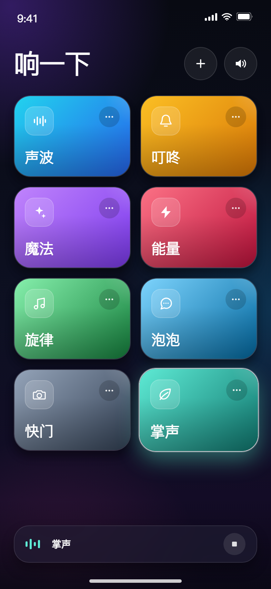

# 响一下 · TapSound

一个极简的 iOS 自定义音效板：点卡片播放声音，支持从文件或 HTTPS 直链导入音频。



> 预览为导入自定义音效后的状态；App 首次启动为空。

## 快速开始

环境：**iOS 17.0+**、**Xcode 15.0+**。

1. 在 macOS 上打开 `TapSound.xcodeproj`。
2. 选择 `TapSound` scheme 和 iPhone 模拟器，按 `⌘R`。
3. 真机运行前，在 **Signing & Capabilities** 选择自己的 Team，并修改 Bundle ID（当前 `com.example.tapsound`）。

首次进入点「添加音效」：

- **从文件**：从「文件」App 选择音频，可多选。
- **从链接**：粘贴 HTTPS 音频直链，自动下载并保存。
- 支持 MP3、M4A、AAC、WAV、AIFF、CAF 等 `AVAudioPlayer` 可播放格式。
- 每张卡片的「···」菜单可以重命名或删除。

所有音频会复制到 App 的 Application Support 目录，元数据保存在本地 `library.json`，重启后仍在。没有内置音效，也不依赖第三方素材。

## 云端构建

仓库已加入 GitHub Actions 工作流 [tapsound-ios.yml](../../.github/workflows/tapsound-ios.yml)：

- 触发：推送到 `deepseek/tapsound` / `deepseek/ios-agent-workspace` 且改动 `ios/TapSound/**`，或手动运行。
- 构建：模拟器版 + 无签名 iPhoneOS arm64 版。
- 产物：`TapSound-unsigned.ipa`、`TapSound-simulator.zip`、构建日志。
- 构建页：<https://github.com/Coran-tech/cc98-reborn-iOS/actions/workflows/tapsound-ios.yml>

**未签名 IPA 不能直接安装。** 下载后用你自己的签名工具签名，再安装到设备。工作流不接触 Apple 账号或证书。

## 结构

```text
TapSound/
├── TapSound.xcodeproj/
├── TapSound/
│   ├── SoundBoardView.swift    # 主界面、导入入口、播放栏
│   ├── SoundCardView.swift     # 卡片、管理菜单
│   ├── AddSoundLinkView.swift  # 从链接导入
│   ├── SoundBoardStore.swift   # 播放、下载、持久化
│   ├── SoundItem.swift         # 音效模型与配色
│   ├── TapSoundApp.swift
│   ├── Color+Hex.swift
│   └── Assets.xcassets/
├── scripts/
│   ├── generate_xcodeproj.py
│   ├── generate_icon.py
│   ├── validate_project.py
│   └── validate_ipa.py
└── preview/
```

## 说明

- 播放采用 `.playback` + `.mixWithOthers`，会忽略 iOS 静音拨片，但不打断其他 App 的音乐。
- 同一时间只播放一个音效，播放栏可停止。
- 「从链接」仅接受 `https://`，防止明文传输。
- 单个导入文件限制 60 MB。
- 没有网络测试、录音或音频编辑功能。

## 校验

```bash
python3 scripts/validate_project.py
```

检查 Xcode 工程引用、scheme、图标、导入/播放关键代码路径和 Swift 括号结构。云端工作流还会实际执行 `xcodebuild` 并校验生成的 IPA。

## 许可

MIT License。见 [LICENSE](LICENSE)。
